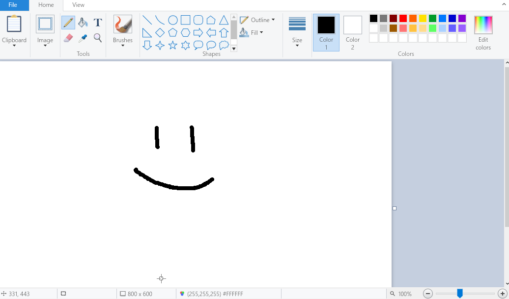

# LS Paint
*A faithful FOSS MS paint clone.*

Built with [Slint](https://slint.dev) and C++.



## Download

**<https://github.com/Bowserinator/ls-paint/releases>** (Windows 64-bit zip/installer, Linux 64-bit)

## Features

- Most features of Window 10's Paint app (minus: black and white mode, fullscreen, edit with paint 3D, thumbnail, and some menu options like print/set as wallpaper)
- Free rotation
- Liquify and blur tools
- Better color picker
- New shortcuts (See shorts section below)

**New Shortcuts:**

- `Ctrl+shift+Z`: Redo (Also Ctrl+Y works)
- `Ctrl+Alt+drag`: Change brush space
- `Ctrl+space+drag`: Zoom in/out
- `Space+drag`: pan
- `E`: Switch to eraser
- `P`: Switch to pencil or brush (whichever you last used)
- `Esc`: Cancel current action

Note: some custom cursors won't work on Wayland because of Wayland limitations.

## Install dependencies

### Windows (VS 2022 Preview Native Tools Command Prompt)

```bat
winget install Git.Git Kitware.CMake Ninja-build.Ninja Rustlang.Rustup LLVM.LLVM
```

### Ubuntu

```sh
sudo apt install build-essential cmake ninja-build git curl pkg-config clang libclang-dev libfontconfig-dev libfreetype-dev libxcb1-dev libxcb-randr0-dev libwayland-dev libxcb-shape0-dev libxcb-xfixes0-dev libxkbcommon-dev libssl-dev libpng-dev
```

### Fedora

```sh
sudo dnf install gcc-c++ cmake ninja-build git curl pkgconf-pkg-config clang clang-devel fontconfig-devel freetype-devel libxcb-devel wayland-devel libxkbcommon-devel openssl-devel libpng-devel
```

## Building

You will need to have the slint headers and compiler installed (see slint repo for more info). Then:

```
mkdir build
cmake -B build
cmake --build build -j16
```
